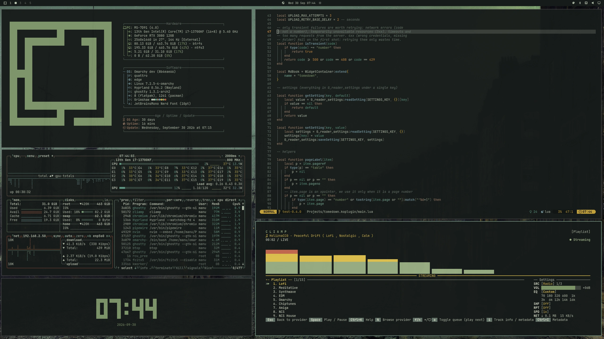
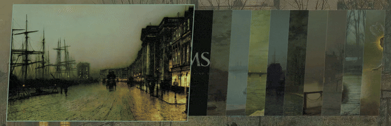

<div align="center">

# 🕯️ Grimshaw

**Gaslight on wet cobbles.**  
A dark Victorian nocturne theme for Omarchy, painted in the colors of John Atkinson Grimshaw's moonlit docks and streets.

[](https://omarchy.org)
[](#-palette)
[](https://en.wikipedia.org/wiki/John_Atkinson_Grimshaw)
[](https://obsidian.md)
[](LICENSE)
[](https://github.com/imanubdesigner/omarchy-grimshaw-theme/stargazers)

</div>

<br>

<p align="center">
  
</p>

> **Artwork & copyright** — The wallpapers here are reproductions of public-domain paintings by John Atkinson Grimshaw, not my own work, and are not covered by any license granted for the theme's code. If you believe something shouldn't be here, [open an issue](../../issues) and I'll remove it immediately.

---

### ✨ Highlights
- 🕯️ **Victorian Nocturne Aesthetic:** Soot-black backgrounds (`#171b1a`) infused with a green cast, wet cobbles, and warm lamplight glow.
- 🎨 **Fine Art Color Palette:** Drawn directly from 19th-century oil paintings by John Atkinson Grimshaw.
- 🖼️ **Public Domain Artwork:** 7 curated nocturne paintings formatted in sharp 16:9 for desktop backgrounds.
- 📓 **Native Obsidian Theming:** Includes a tailored `obsidian.css` theme handled automatically by Omarchy.
- 🚀 **Full Omarchy Integration:** Complete styling for Waybar, terminal applications, and system menus.

---

## 🚀 Installation

Install directly via the Omarchy CLI:

```bash
omarchy theme install https://github.com/imanubdesigner/omarchy-grimshaw-theme
```

Then pick **Grimshaw** from *Style > Theme* in the Omarchy menu.

> **Tip:** If the icons keep the previous theme's colors after switching, close Nautilus (`nautilus -q`) and reapply the theme.

---

## 🖼️ Included Wallpapers

These are the wallpapers curated for the theme — drop them into `~/.config/omarchy/backgrounds/`.

<p align="center">
  
</p>

---

## 🎨 The Paintings | Seven Grimshaw Nocturnes

Seven Grimshaw nocturnes in 16:9, each linked to historical and gallery archives:

- [*Canny Glasgow*](https://www.museothyssen.org/en/collection/artists/grimshaw-john-atkinson/canny-glasgow), 1887 | Museo Thyssen-Bornemisza
- [*November Moonlight*](https://www.christies.com/en/lot/lot-5287653), 1883 | Christie's
- [*Quai de Paris, Rouen*](https://commons.wikimedia.org/wiki/File:John_Atkinson_Grimshaw_Quai_de_Paris_Rouen.jpg), 1893 | Wikimedia Commons
- [*Reflections on the Thames, Westminster*](https://en.wikipedia.org/wiki/Reflections_on_the_Thames,_Westminster), 1880 | Wikipedia
- [*Shipping on the Clyde*](https://en.wikipedia.org/wiki/Shipping_on_the_Clyde), 1881 | Wikipedia
- [*Silver Moonlight*](https://commons.wikimedia.org/wiki/File:Silver_Moonlight_by_John_Atkinson_Grimshaw.jpg), 1880 | Wikimedia Commons
- [*Whitby at Night*](https://www.christies.com/en/lot/lot-6248738), c. 1876 | Christie's

---

## 🎨 Palette

Everything is generated from a single `colors.toml`.
Soot-black backgrounds with a green cast, pale sage text, and a sage-teal accent. Lamp-yellow and brick-red are preserved for warnings and highlights, the way a single lit window stands out in the paintings.

| Preview | Name | Mood / Role | Hex |
| :---: | :--- | :--- | :--- |
|  | **Background** | Soot-black with green cast | `#171b1a` |
|  | **Foreground** | Pale sage mist | `#b8c2ae` |
|  | **Accent** | Sage-teal UI accent | `#7fa38d` |
|  | **Yellow** | Gaslight & lit window glow | `#c9a63a` |
|  | **Red** | Victorian brick & alerts | `#b0573f` |
|  | **Orange** | Amber warmth | `#c98a3e` |
|  | **Green** | Mossy cobblestones | `#7f966b` |
|  | **Cyan** | Wet harbour reflections | `#5c9680` |
|  | **Blue** | Cold moonlight | `#6f8f96` |

Icons use **Yaru-sage**.

---

## 🔗 Credits

- Paintings by [John Atkinson Grimshaw](https://en.wikipedia.org/wiki/John_Atkinson_Grimshaw) (1836–1893), in the public domain.
- Wallpapers from [Wallhaven](https://wallhaven.cc) and [Wikimedia Commons](https://commons.wikimedia.org).
- Built for [Omarchy](https://omarchy.org).

The paintings are in the public domain; the reproductions here are not original work and no license is granted for them. Takedown requests: [open an issue](../../issues).

## 📄 License

Released under the [MIT License](LICENSE). The license covers the theme's code and configuration only, not the images (see Credits).

---

<div align="center">

### ⭐ Support & Stargazers
If you enjoy the Victorian atmosphere of Grimshaw on your desktop, please consider leaving a **Star** ⭐!

</div>
